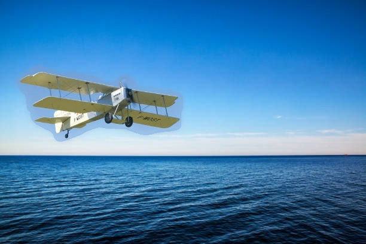
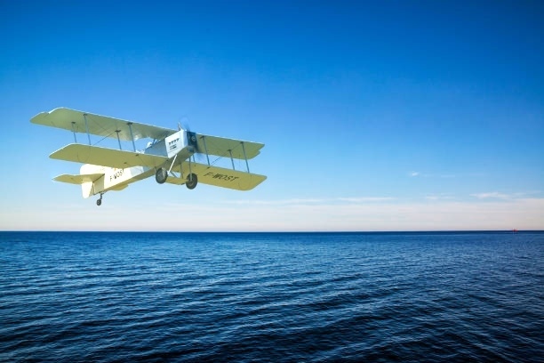
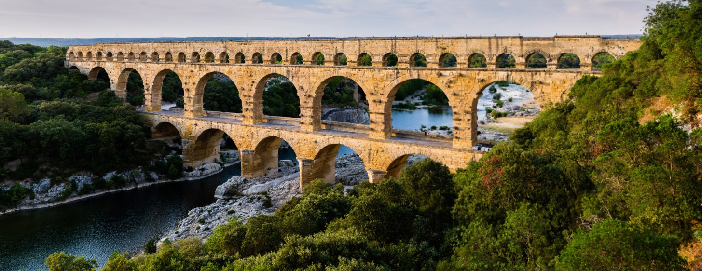
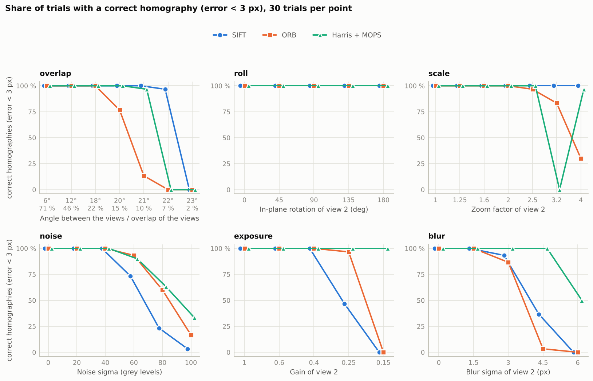

# Gradient Domain Editing & Panorama Stitching

Two classic image-compositing problems, implemented from scratch, rebuilding the core mathematics of each approach rather than relying on existing libraries (OpenCV is used for reading/resizing images and, in Part 2, for the SIFT and ORB extractors that the assignment allows).

| | Problem | Code | Notebook |
|---|---|---|---|
| **Part 1** | Image blending: naive alpha blending, Laplacian pyramid, Poisson (gradient domain) | `src/image_blending` | `notebooks/demo_image_blending.ipynb` |
| **Part 2** | Panorama stitching: features → matching → homography → warping → blending, with three feature extractors compared | `src/panorama/` | `notebooks/demo_panorama.ipynb` |

The two parts meet in the last stage of the panorama: the multi-band blender of Part 2 generalises Part 1's two-image Laplacian blending to *K* images and re-uses its pyramid operators (`build_gaussian_pyramid`, `build_laplacian_pyramid`, `pyr_up`).

**Contents:** [Project structure](#project-structure) · [Setup](#setup) · [Tests](#tests) · [Part 1: Image blending](#part-1-image-blending) · [Part 2: Panorama stitching](#part-2-panorama-stitching) · [References](#references)

---

## Project Structure

```
Gradient-Domain-Editing-and-Panorama-Stitching/
├── pyproject.toml              # packaging and dependencies: `pip install -e ".[dev]"` makes src/ importable
├── src/
│   ├── image_blending/         # Part 1
│   │   ├── config.py
│   │   ├── utils.py
│   │   ├── naive_blend.py
│   │   ├── laplacian_blend.py
│   │   └── poisson_blend.py
│   └── panorama/               # Part 2
│       ├── features.py
│       ├── harris_mops.py
│       ├── matching.py
│       ├── homography.py
│       ├── warp.py
│       ├── blend.py
│       ├── stitcher.py
│       ├── synthetic.py
│       ├── metrics.py, viz.py
│       └── config.py
├── notebooks/
│   ├── demo_image_blending.ipynb   # Part 1: run and compare the three blending methods
│   └── demo_panorama.ipynb         # Part 2: derivations, experiments, discussion (executed)
├── data/
│   ├── image_blending/
│   └── panorama/
├── scripts/                    # run_scenes.py, run_synthetic.py, make_figures.py (experiments and charts)
│                               # describe_scenes.py, analyse_overlap_bands.py, analyse_chain_drift.py (diagnostics)
├── tests/                      # pytest: unit_test/ and e2e_test/ for each part (see Tests)
│   ├── image_blending/
│   └── panorama/
├── docs/
└── run_panorama.py             # command line front end of Part 2
```

## Setup

```bash
py -3.12 -m venv venv
venv/Scripts/activate           # Linux/macOS: source venv/bin/activate
pip install -e ".[dev]"
```

## Tests

The tests live in `tests/` and are split per part into **unit tests** (`unit_test/`, one file per module) and **end-to-end tests** (`e2e_test/`, a whole pipeline):

```text
tests/
├── image_blending/                       # Part 1
│   ├── e2e_test/
│   │   └── test_blending_pipeline_e2e.py # end-to-end multi-image blending
│   └── unit_test/
│       ├── test_config.py                # hyperparameter schemas and validation
│       ├── test_laplacian_blend.py       # Gaussian and Laplacian pyramid blending
│       ├── test_naive_blend.py           # cut-and-paste linear alpha baseline
│       ├── test_poisson_blend.py         # discrete Poisson solver (gradient domain)
│       └── test_utils.py                 # colour conversions, gradients, pyramid maths
└── panorama/                             # Part 2
    ├── e2e_test/
    │   └── test_stitcher_e2e.py          # complete multi-image stitching pipeline
    └── unit_test/
        ├── test_blend.py                 # multi-band and feather seam blending
        ├── test_config.py                # stitching configuration and dataclasses
        ├── test_features.py              # SIFT / ORB extractors and keypoints
        ├── test_harris_mops.py           # Harris corners, ANMS and MOPS descriptors
        ├── test_homography.py            # DLT, conditioning, RANSAC, LM refinement
        ├── test_matching.py              # nearest-neighbour matching and Lowe ratio test
        ├── test_metrics.py               # PSNR, SSIM and reprojection metrics
        ├── test_synthetic.py             # synthetic views and difficulty sweeps
        └── test_warp.py                  # projective transformation and canvas layout
```

| subsystem | test files | tests | statement and branch coverage |
|---|---:|---:|---:|
| Image blending | 6 | 40 | 100 % |
| Panorama | 10 | 100 | 100 % |
| **Total** | **16** | **140** | **100 %** (≈ 9.3 s) |

The tests use `pytest` and `pytest-cov` (both installed by `pip install -e ".[dev]"`). Run them from the repository root:

```bash
# everything, with line and branch coverage and an HTML report in coverage_html/
python -m pytest --cov=src --cov-report=term-missing --cov-report=html:coverage_html tests/

# one part, with its own coverage
python -m pytest --cov=src/image_blending --cov-report=term-missing tests/image_blending/
python -m pytest --cov=src/panorama --cov-report=term-missing tests/panorama/

# one layer
python -m pytest tests/image_blending/unit_test/ tests/panorama/unit_test/
python -m pytest tests/image_blending/e2e_test/ tests/panorama/e2e_test/

# one file
python -m pytest tests/panorama/unit_test/test_homography.py -v
```

Open `coverage_html/index.html` in a browser to browse the coverage report (Windows: `start coverage_html/index.html`; macOS: `open ...`; Linux: `xdg-open ...`). The checks of Part 2 compare each component with an independent reference (see [Part 2](#part-2-panorama-stitching)).

The results in this repository were produced with Python 3.13, OpenCV 5.0.0, NumPy 2.5, SciPy 1.18 and Matplotlib 3.11.

---

# Part 1: Image Blending

Given a **source** image, a **mask**, and a **target** image, the goal is to seamlessly composite the masked region of the source onto the target, minimising visible seams at the boundary.

| Method | Idea |
|---|---|
| Naive copy | Alpha blending: `C = α·F + (1−α)·B` |
| Laplacian blending | Blend each frequency band separately via Gaussian/Laplacian pyramids |
| Poisson blending | Solve `Lf = b` to match source gradients while respecting target boundary conditions |

## Usage

**1. Prepare your images**: place `source`, `mask`, and `target` images with the same filename into their respective folders under `data/`.

To create a mask, use [GIMP](https://www.gimp.org/): open the source image, use the free select or fuzzy select tool to outline the region you want to blend, then fill the selection with white on a black background and export as the mask image.

**2. Configure** `src/image_blending/config.py`:

```python
IMAGE_NAME        = "01.jpg"
GRAD_MIX          = True    # Poisson only: use mixed gradients
NUM_LEVELS        = 3       # Laplacian only: pyramid levels
USE_MANUAL_OFFSET = False   # True: use MANUAL_OFFSETS | False: interactive selector
```

**3. Run** `notebooks/demo_image_blending.ipynb`: the notebook loads the images, runs all three methods, displays a side-by-side comparison, and saves results to `data/result/image_blending`.

## Data
 
`data/image_blending/` holds three examples (`01.jpg`, `02.jpg`, `03.jpg`). An example is a **source**, a **mask** and a **target** picture with the same file name in `source/`, `mask/` and `target/`; the three blended pictures of every example are written to `result/`. The folder is set by `DATA_ROOT` in `src/image_blending/config.py`. Add your own example by putting the three pictures under a new common name and setting `IMAGE_NAME`; the layout, the sizes of the provided examples and how to make a mask are in `data/image_blending/README.md`.

### Interactive offset selector

When `USE_MANUAL_OFFSET = False`, an OpenCV window opens for you to position the source on the target interactively:

| Control | Action |
|---|---|
| Mouse move / left-click | Set placement position |
| Scroll up / `+` | Scale source up (+5%) |
| Scroll down / `-` | Scale source down (-5%) |
| Enter | Confirm |

## Methods

Three methods are implemented to compare their trade-offs in quality, smoothness, and computational cost. The full mathematical derivation of each method is documented with worked examples in `notebooks/demo_image_blending.ipynb`.

### Naive copy
Direct alpha blend using the mask. Fast but produces visible colour discontinuities at the boundary.

### Laplacian blending
Decomposes source, target, and mask into Gaussian/Laplacian pyramids, then blends each frequency band independently. Coarser levels use a progressively blurred mask, giving smooth colour transitions without sacrificing high-frequency detail. Does not operate in the gradient domain.

### Poisson blending
Gradient-domain method that finds a result image whose gradients best match the source gradients inside the mask, subject to the target's boundary conditions. Reduces to solving a sparse linear system `Lf = b` per colour channel. Supports mixed gradients (`GRAD_MIX=True`) for better handling of semi-transparent objects.

## Results
The images below demonstrate the output of each method using a sample input.

*Naive copy*
<p align="center">
  
</p>

*Laplacian Blending*
<p align="center">
  
</p>

*Poisson Blending*
<p align="center">
  
</p>

---

# Part 2: Panorama Stitching

A panorama is a set of photographs of one scene, taken from one place with the camera turned between the shots, that has been **registered** (every image mapped into a common frame) and **composited** (the overlaps blended into one picture). For a pure camera rotation the mapping between two images is a homography, `H = K₂ R K₁⁻¹`, whatever the depth of the scene — which is why the whole problem reduces to estimating 3 × 3 matrices from matched features.

```
images ─▶ resize + grey ─▶ keypoints + descriptors ─▶ matches per pair (ratio test, one-to-one)
       ─▶ RANSAC homography per pair ─▶ overlap graph ─▶ maximum spanning tree, reference image
       ─▶ chain the homographies ─▶ canvas ─▶ inverse warp ─▶ (gain compensation) ─▶ multi-band blend ─▶ panorama
```

The **same pipeline** runs with three feature extractors — only the first stage changes — so that they can be compared fairly:

| extractor | detector | descriptor | source |
|---|---|---|---|
| **SIFT** | DoG scale-space extrema | 128-D gradient histogram | OpenCV |
| **ORB** | FAST corners on an image pyramid | 256-bit rotated BRIEF | OpenCV |
| **Harris + MOPS** | multi-scale Harris corners (harmonic mean), ANMS | 8 × 8 oriented, normalised patch | **from scratch** (`harris_mops.py`) |

What is written from scratch (NumPy/SciPy): Harris + MOPS, brute-force 2-NN matching with the ratio test, normalised DLT, RANSAC with an adaptive number of iterations, Levenberg–Marquardt refinement, degeneracy tests, bilinear sampling, inverse warping, canvas layout, overlap graph and spanning tree, multi-band blending for *K* images, gain compensation. Each component is tested against an independent reference (`cv2.BFMatcher`, `cv2.warpPerspective`, known homographies, a known rotation, synthetic views with exact ground truth).

## Usage

```bash
python run_panorama.py --scene boat --method sift                    # a sample scene
python run_panorama.py --scene boat --method orb --blend feather
python run_panorama.py --folder path/to/my/photos --compare          # all three extractors, one table
python run_panorama.py --images a.jpg b.jpg c.jpg --gain --out pano.jpg
```

or from Python:

```python
from panorama.config import StitchConfig
from panorama.stitcher import PanoramaStitcher, load_images

result = PanoramaStitcher(StitchConfig(method="sift", blend="multiband", gain_compensation=True)).stitch(load_images(paths))
cv2.imwrite("panorama.jpg", result.panorama)    # also: result.homographies, .pairs (matches, inliers, RMSE), .timings, ...
```

The photographs may be given in any order: the overlap graph is estimated from the matches, the central image of the spanning tree becomes the reference and images that do not overlap with the rest are dropped and reported.

Reproduce everything:

```bash
python scripts/run_scenes.py       # 5 real scenes x 3 extractors             (~2 min)  -> data/panorama/result/
python scripts/run_synthetic.py    # controlled study with ground truth      (~10 min)  -> data/panorama/result/synthetic/
python scripts/make_figures.py     # figures and markdown tables from the CSV files
python scripts/describe_scenes.py  # sizes, greyscale photographs and pairwise overlaps of every scene   (~15 s)
python scripts/analyse_overlap_bands.py   # content change or mis-registration? bands of the overlap, shifts  (~40 s)
python scripts/analyse_chain_drift.py     # error accumulated by chaining homographies                      (~40 s)
python scripts/make_report_figures.py     # figures of the written report (docs/figures/)
python -m pytest tests -q          # 41 tests                                 (~20 s)
jupyter notebook notebooks/demo_panorama.ipynb
```

`notebooks/demo_panorama.ipynb` (already executed) contains the mathematics — homography from a camera rotation, why Hartley normalisation works, the DLT degeneracies, the RANSAC iteration count, the `K`-image multi-band blender, the gain-compensation linear system — each checked numerically, followed by the experiments and a discussion.

## Data

`data/panorama/input/` holds five scenes (2–4 photographs each) from the stitching test data of the OpenCV project (`boat`, `newspaper`, `cathedral` = `a1–a3`, `mountain` = `b1, b2`, `aqueduct` = `s1, s2`; see `data/panorama/README.md`). Add your own scene by creating `data/panorama/input/<name>/` with two or more photographs; it is picked up by `run_panorama.py --scene <name>` and by `scripts/run_scenes.py`. The sample images of the course were not available when this part was written; they can be dropped in the same way.

## Results

SIFT panorama of the `aqueduct` scene (2 photographs, 1688 RANSAC inliers, RMS reprojection error 0.24 px):

<p align="center">
  
</p>

All 15 combinations (5 scenes × 3 extractors) are stitched without manual intervention; every panorama is in `data/panorama/result/<scene>/`. Mean over the five scenes (`data/panorama/result/scenes_summary.md` has the table per scene):

| extractor | keypoints / image | inlier ratio | RMS reprojection error (px) | overlap NCC (high-pass) | features / image (ms) |
|---|---:|---:|---:|---:|---:|
| SIFT | 3028 | 0.89 | **0.65** | 0.833 | 144 |
| ORB | 3900 | 0.92 | 1.08 | 0.826 | **18** |
| Harris + MOPS | 2596 | **0.94** | 0.83 | 0.825 | 297 |

On the real scenes the extractors are hard to tell apart in the *final* panorama (the agreement of the overlaps differs by at most 0.05 and is dominated by the scene: moving water, a greyscale photograph in the set, parallax). They differ in the geometry they deliver and, above all, in how much they can take. A **controlled study** (two views of a photograph rendered with a virtual camera rotation, exact ground truth, one difficulty factor changed at a time, 30 trials per level, ≈ 3 × 1050 trials) measures the limits:

<p align="center">
  
</p>

Hardest level still solved in at least 90 % of the trials (`data/panorama/result/synthetic/summary.md` has every level, with the median error):

| factor | SIFT | ORB | Harris + MOPS |
|---|:---:|:---:|:---:|
| overlap of the two views | **7 %** | 22 % | 10 % |
| in-plane rotation | 180° | 180° | 180° |
| zoom of one view | **4×** | 2.5× | 2.5× |
| noise σ (grey levels) | 40 | **60** | **60** |
| exposure (gain of one view) | 0.4 | 0.25 | **0.15 (all)** |
| blur σ (px) | 3 | 1.5 | **4.5** |
| accepted pair with a wrong homography (of 1050) | **25** | 77 | 46 |

Blending (`data/panorama/result/figures/blend_<scene>.jpg`, and the controlled test in the notebook): with a deliberate 3.6 px registration error, averaging and feathering lose 20–23 % of the sharpness (double edges), multi-band blending less than 2 %; multi-band blending alone leaves a soft exposure difference, which gain compensation removes (37 → 7 grey levels).

### What the experiments showed

* **SIFT** is the most accurate in every scene and has the widest range; **ORB** extracts about 8× faster than SIFT but is the least accurate and loses a pair first when overlap, zoom or blur get hard; **Harris + MOPS** has the cleanest matches and is the most tolerant of exposure and blur, but is slow in NumPy and has a coarse scale sampling.
* **SIFT and ORB fail in dark views because of an absolute detector threshold, not because of their descriptors**: lowering `contrastThreshold` / `fastThreshold` in proportion to the gain restores both completely (4/4 correct homographies at gain 0.15), while the relative threshold of Harris is immune.
* **Harris + MOPS shows a sawtooth in the zoom factor**: a pyramid with factor 2 samples the scale once per octave, so inliers peak at zoom 1, 2, 4 (1645, 636, 139) and vanish half an octave in between (12 at 1.41, 4 at 2.83).
* **Coordinates matter at the sub-pixel level**: OpenCV's SIFT and ORB keypoints are biased by a fraction of a pixel with respect to the pixel-centre convention (found with an exact 180° flip test, corrected in `features.py`).
* **Repeated structure can fake an overlap**: lines of text produced 42 "inliers" that were all copies of one point; the rank test of the DLT matrix rejects such pairs. These safety nets are not guarantees — the study contains accepted-but-wrong pairs (table above).
* **A low overlap agreement has two possible causes, and a shift test tells them apart**: in the `boat` set the water and the ice changed between the shots (no shift of up to 12 px restores the correlation), while in one pair the sky is far from every inlier and correlates only partly after a shift of several pixels (consistent with a homography extrapolated badly there; moving clouds are not excluded) — `scripts/analyse_overlap_bands.py`.
* **Chaining homographies accumulates error**: against pairs that are not tree edges the chain disagrees by 0.08–0.26 px on the planar newspaper and by 0.6–3.7 px RMS (up to 12 px at the corners) on the three-dimensional scenes — `scripts/analyse_chain_drift.py`.
* **Hartley normalisation** reduces the error of the DLT for matches concentrated in a strip from 28 to 8 px; **Levenberg–Marquardt** changes the real-data results by less than 0.001 px (reported honestly in the notebook).

### Limitations

Planar projection stretches wide panoramas (the boat panorama is bent; a cylindrical/spherical projection is not implemented); a homography is exact only for a camera rotation or a plane, so parallax and moving content (water, foliage) leave ghosts that multi-band blending hides but cannot remove; one gain per image is the whole photometric model; there is no bundle adjustment or loop closure; matching and blending are NumPy code written for clarity, not speed (the 4-image boat set takes ≈ 13 s).

---

## References

- Pérez, P., Gangnet, M., & Blake, A. (2003). *Poisson image editing*. ACM SIGGRAPH 2003.
- Burt, P., & Adelson, E. (1983). *The Laplacian pyramid as a compact image code*. IEEE Transactions on Communications.
- Burt, P., & Adelson, E. (1983). *A multiresolution spline with application to image mosaics*. ACM Transactions on Graphics.
- Arnebäck, E. *Laplacian Pyramids*.
- Salazar Cavazos, J. *Image Blending*.
- Hartley, R., & Zisserman, A. (2004). *Multiple View Geometry in Computer Vision*, 2nd ed. Cambridge University Press.
- Brown, M., Szeliski, R., & Winder, S. (2005). *Multi-image matching using multi-scale oriented patches*. CVPR 2005.
- Brown, M., & Lowe, D. G. (2007). *Automatic panoramic image stitching using invariant features*. IJCV 74(1).
- Lowe, D. G. (2004). *Distinctive image features from scale-invariant keypoints*. IJCV 60(2).
- Rublee, E., Rabaud, V., Konolige, K., & Bradski, G. (2011). *ORB: an efficient alternative to SIFT or SURF*. ICCV 2011.
- Fischler, M. A., & Bolles, R. C. (1981). *Random sample consensus*. Communications of the ACM 24(6).
- Harris, C., & Stephens, M. (1988). *A combined corner and edge detector*. Alvey Vision Conference.
- R. Szeliski, *Computer Vision: Algorithms and Applications*, 2nd ed., Springer, 2022, chapter 8.

## License

This project is licensed under the MIT License. See [LICENSE](LICENSE) for details. The sample photographs in `data/panorama/input/` come from the OpenCV test data and keep their original rights (see `data/panorama/README.md`).

## Author

laveanfield — https://github.com/laveanfield
